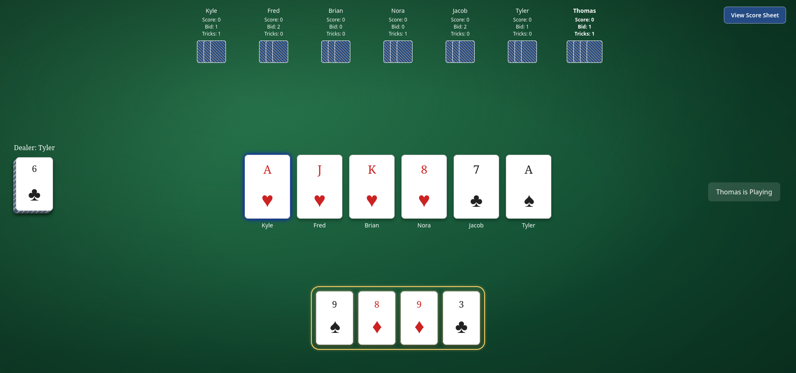

# Up And Down The River

A webapp for playing the card game "Up and Down the River"



## Game Rules

The gameplay is similar to spades, but there are differences that make it unique.

The game is broken down into rounds based on the number of cards dealt to each player. The first round is 7 cards, then 6, then 5, down to 1, then back up to 7, totaling 13 rounds.

In each round, the dealer will deal (starting at the player to their left, which we will call the Leader) the number of cards based on the round (let's say it's the first round, so 7 cards). Then they will flip another card from the deck to be the trump card (let's say the 8 of diamonds).

Once all the cards are dealt and trump is established, each player will bid, starting with the leader and finishing with the dealer. The bid is a guess for how many tricks that player will take in this round. We'll come back to bidding after explaining how the tricks work.

After the bids are in, the leader will play a card (let's say the ace of hearts). This sets the leading suit (hearts). Each player will then play a card. If they have a card of the leading suit they must play it. Only if they do not have a heart (in this example) can they play another suit. After each player has played a card, the highest value of the leading suit will win.

Unless a trump was played. If a player doesn't have a leading suit card, they have two options. They can sluff (meaning they play one of the two suits that aren't the lead or the trump), and this card cannot win the trick. Or they can trump it. Any trump card will beat any card of the leading suit. In our example, a 2 of diamonds will beat the ace of hearts played by the leader.

After each player has played a card, the winner is determined based on the highest trump card, or if no trumps were played, the highest leading suit card. The player that wins the trick will become the leader for the next trick. This continues until the players are out of cards. Then the player to the left of the dealer becomes the new dealer, and they deal the next round.

### Scoring

It's important to know how the scoring works before discussing the bidding. In each round of 13, each player will get a base score of 30 points. If they bid 0 and win 0 tricks, they will get 30 points. So a completely bidless and scoreless game will result in a final score of 390.

If a player bids 1 and wins 1 trick, they get an additional 10 points, so 40. 2 bids and 2 tricks gets 50, 3 bids and 3 tricks gets 60, etc.

If a player does not exactly match their bids and tricks, they will lose points from the base 30, based on the difference in bids and trick. So if they bid 1 and win 0, they will lose 10 points from the base and get 20. If they bid 2 and win 0, they will get 10. The same applies for winning more than you bid. If they bid 0 and win 1, they will also get 20 points.

This is why it's critical to get exactly how many tricks you bid. Even if you bid 6 and win 5, you only get 20 points. There's no credit for winning those 5 tricks.

### Bidding

Now you can see why bidding is so important. You have to consider many factors when determining how many tricks you can win.

The trump suit is the biggest consideration. If you have no trumps, your chances of winning a trick decrease.

If you have the lead, you get to pick the leading suit, which everyone else must follow. This is particularly useful when there are a lot of cards in play (say on the 7 card round), because most of the deck is dealt out, so it's very likely all players will have your leading suit and must follow it. So leading an ace is likely to win, because no one can trump it if they are following suit. This impact reduces as the number of cards reduce. On the 1 card round, there's no guarantee players will have your suit, and this round is often unpredictable.

Another consideration is what other players bid. This is why being the dealer is advantageous, because you get to bid last and see what everyone else is bidding. You can't rely on other players matching their bids, but it's a good indication of how good their hand is.

Lastly I will mention sluffing. This is a very important concept, often overlooked. Sluffing is when you play a card that isn't of the lead or trump suit. When you sluff you can never win with that card. But crucially it can be a chance to remove a card that may win a later trick. For example, on the 7 card round you bid 1 and won the first trick. You must try to avoid winning any more tricks this round. But if you have an ace, and someone leads that suit, there's a good chance it will win. So if you get the opportunity to sluff that ace (in a trick where you can't follow suit) you should take it, to reduce the chances of it winning later in the round.

Conversely if you have bid but have yet to win enough tricks, if you have an situation where you can't follow suit or trump it, you would probably want to play a low card. This leaves your higher cards available if someone happens to lead that suit, giving you a chance to win.

## Gameplay

First the user is directed to a login page, where they must enter email and password to authenticate with the Firebase Authentication system. An optional username field will set the in-game name for the player. When undefined, it will use the username portion of the email.

Then the user is directed to the lobby page, which will show the list of players currently in the lobby. The first player to login becomes the host. They will have a button to begin the game. Only 7 players can join the lobby, additional players will go to an error page.

When the host starts the game, the database is initialized, the player order is randomized, and players are directed to the game page. At this point the host cannot disconnect. All of the game logic is run from the host's browser. Other users simply watch the game state change, and interact when they are prompted to bid or play a card. These users can leave and rejoin by logging in again. All players will see a button to display the score sheet in a new tab. The host will see a button to wipe the database for a fresh game.

## Game Configuration

The firebase configuration is stored in `firebase-config.json`. It should have the structure:

```json
{
    "apiKey": "API_KEY",
    "authDomain": "up-and-down-the-river-WXYZ.firebaseapp.com",
    "projectId": "up-and-down-the-river-WXYZ",
    "storageBucket": "up-and-down-the-river-WXYZ.firebasestorage.app",
    "messagingSenderId": "MSG_SND_ID",
    "appId": "1:ABC:web:XYZ"
}
```

These keys are mandatory to work with the firebase backend.

Optionally the following keys can configure the firebase emulator for development:

```json
{
    "runInEmulator": true,
    "emulatorHost": "192.168.1.202"
}
```

When `runInEmulator` is `true` and `emulatorHost` is defined, the Auth and Database emulators will use the specified host for the emulator endpoints.

## Running In Production

To run the game in firebase, follow these steps:

1. Create a Firebase project.
2. Create user accounts in the Authentication page.
3. Enable the Realtime Database for the project.
4. Host the site (this requires the firebase CLI).

In my environment, I run the firebase CLI on the server where I run the emulators. The `copy-to-dev.sh` script copies the `site` directory to this machine. Then run `deploy-to-prod.sh` to disable emulation in the config and deploy the site to the Firebase Hosting platform.
